# 🎓 Will I Pass? — Predicting CS Student Success with Neural Networks

An end-to-end machine learning project that predicts whether a computer science student will **pass** a course, and their **exact final score**, from their habits: study hours, sleep, coffee, LeetCode grinding, GitHub commits, part-time jobs and more.

It covers the whole data science workflow: messy raw data in **3 file formats** → cleaning → EDA → a **neural network built from scratch in NumPy** → tuned **scikit-learn MLPs** → an interactive CLI that predicts *your* chances.

```
$ python predict.py --study 6 --sleep 4.5 --coffee 6 --job 1

Probability of passing: █████░░░░░░░░░░░░░░░░░░░░░░░░░ 18.8%
Verdict: 🚨 At risk. Time to change some habits.
  💤 Tip: more sleep is one of the strongest levers in this dataset.
  📚 Tip: students who study 15+ hrs/week pass far more often.
  ☕ Tip: past ~3 cups a day, scores start dropping.
```

---

## 📊 Results

| Model | Task | Result |
|---|---|---|
| `MLPClassifier` (32, 16), ReLU, Adam, early stopping | Pass / Fail | **Accuracy 83.2%** · Precision 0.84 · Recall 0.91 · F1 0.88 · **ROC-AUC 0.914** |
| Neural net **from scratch in NumPy** (hand-written backprop) | Pass / Fail | **Accuracy 85.2%** |
| `MLPRegressor` (32,), α = 10 | Final score | **RMSE 5.64 points · R² 0.810** |
| Linear regression via Normal Equation (NumPy) | Final score | RMSE 5.73 · R² 0.797 (baseline) |

> 💡 **Lesson learned:** the neural net only beats plain linear regression by a little, because most of the signal here is linear. Always build a simple baseline before reaching for a neural network.

---

## 🖼️ Highlights

**The network discovered the "sleep sweet spot" by itself.** Decision boundaries for 3 activation functions trained on just two features:
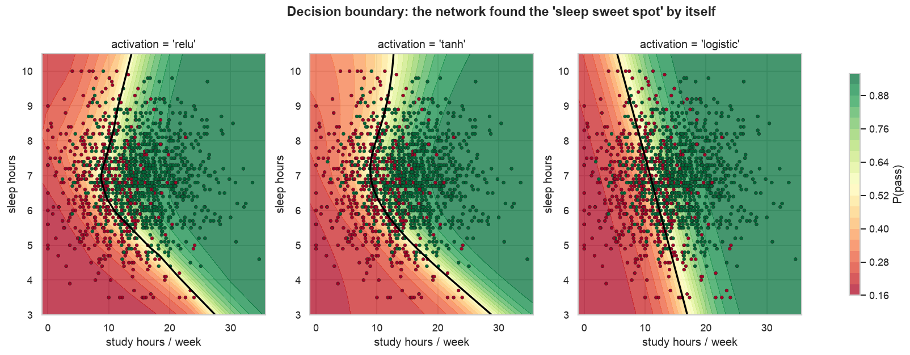

**Underfitting vs overfitting vs a good fit.** Watch the validation loss explode in the overfit model:
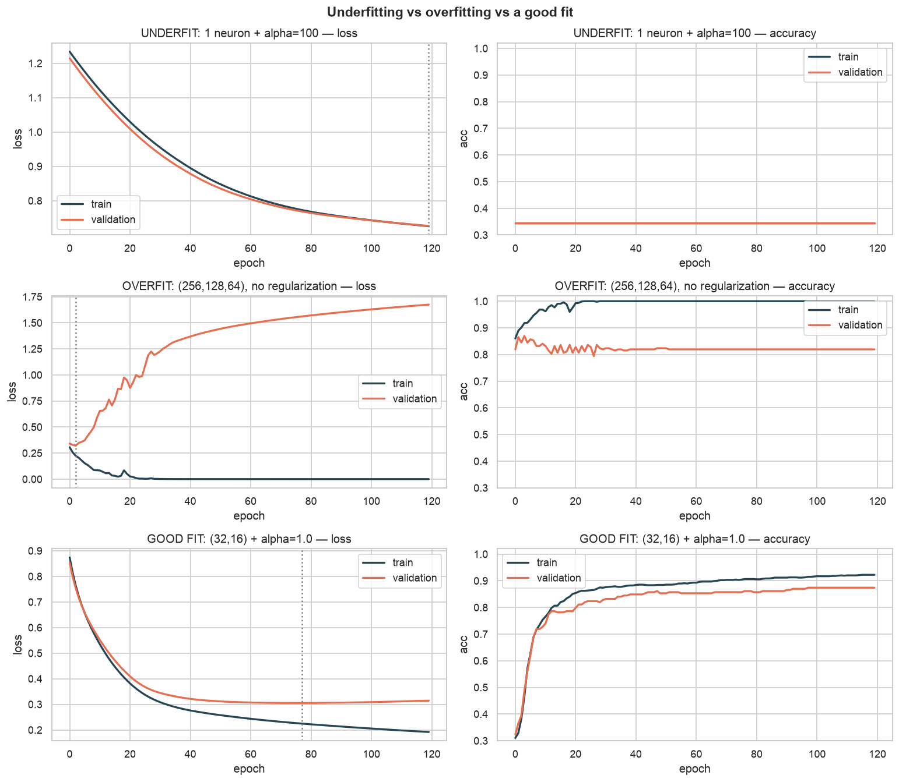

**Confusion matrix + ROC curve** (sklearn MLP vs our from-scratch NumPy MLP):
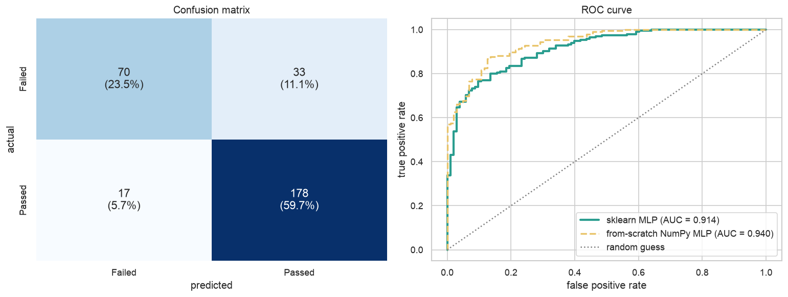

<details>
<summary><b>More figures (EDA, hyperparameters, regression)</b></summary>

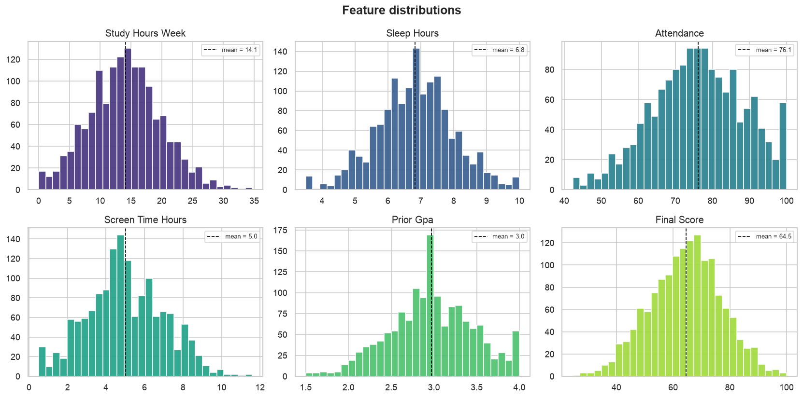
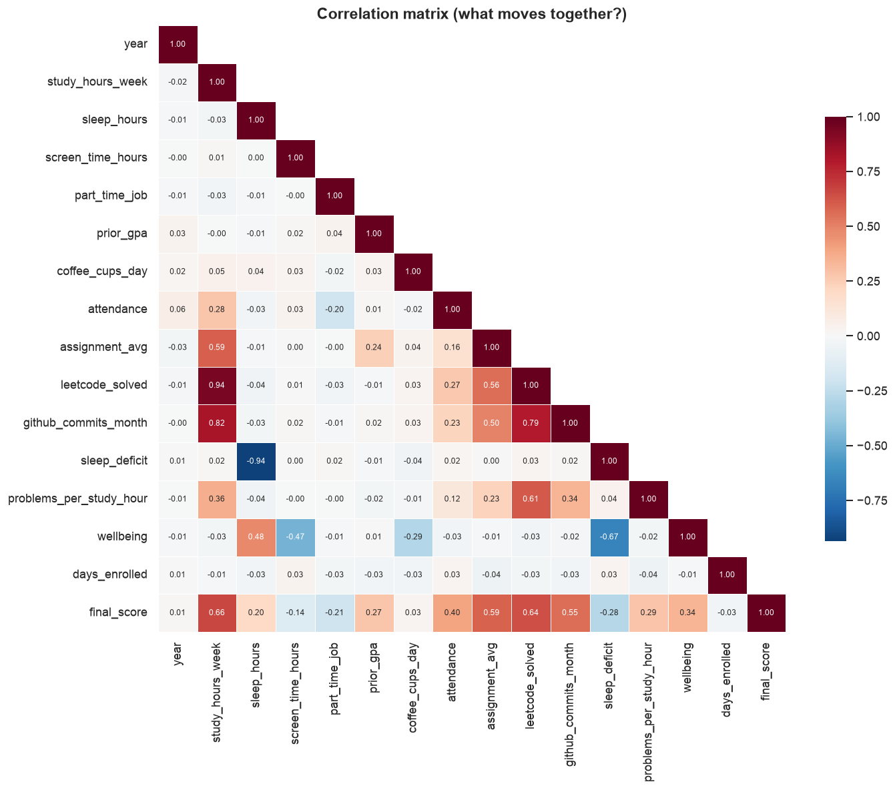
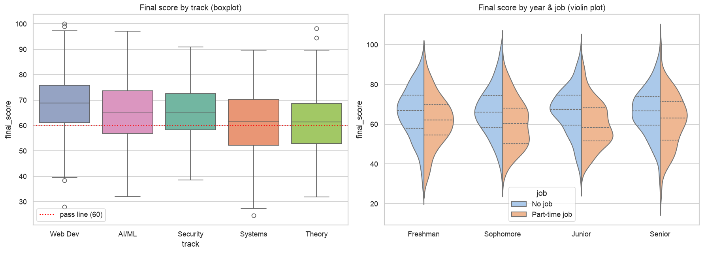
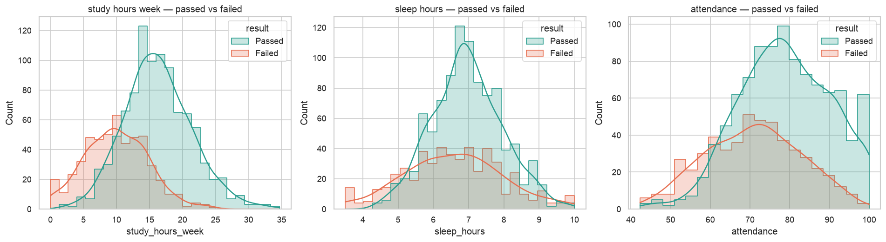
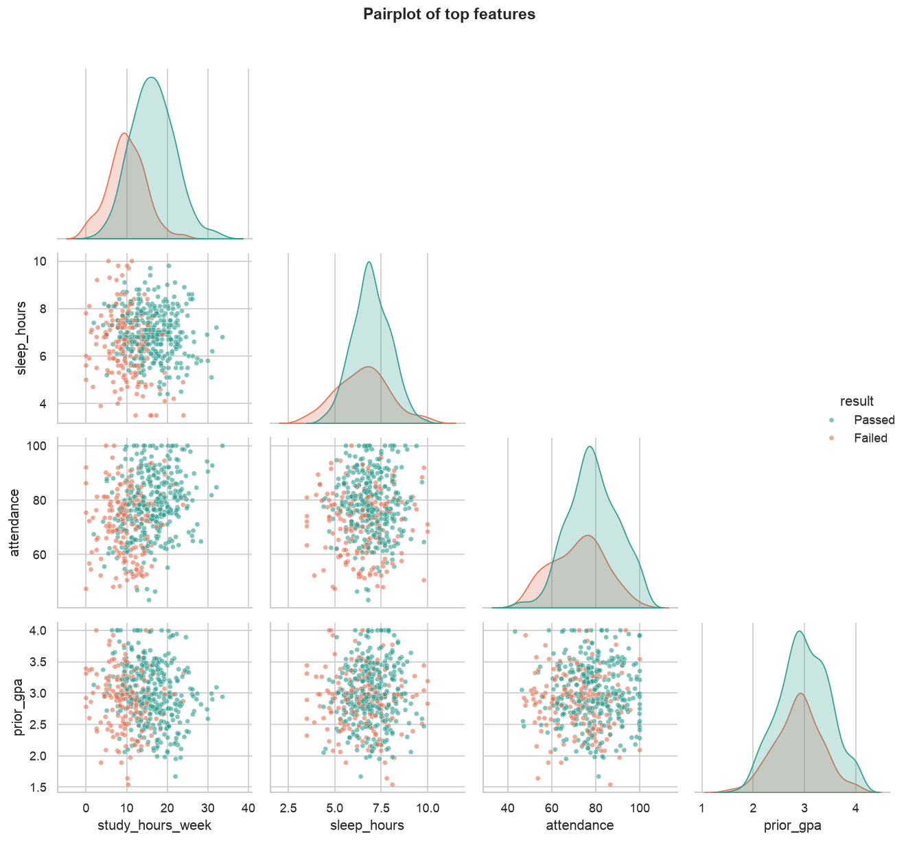
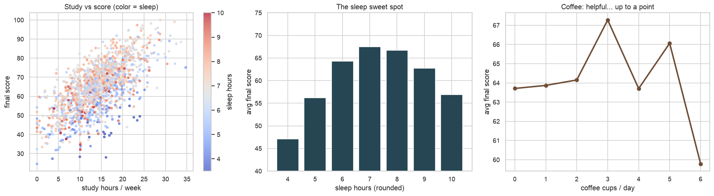
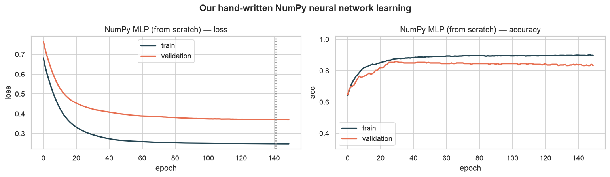
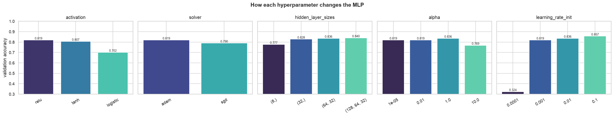
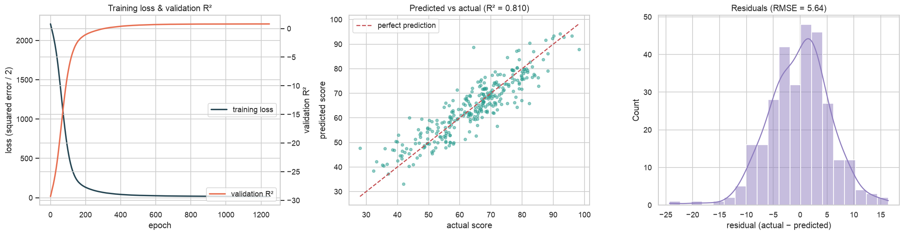
</details>

---

## 🚀 Quick start

```bash
git clone https://github.com/vaidikcode/student-success-ml.git
cd student-success-ml
python -m venv .venv && source .venv/bin/activate
pip install -r requirements.txt

python main.py       # runs everything (~10 seconds), regenerates figures/ and results/
python predict.py    # answer a few questions -> your probability of passing
```

The full console output of a run is in [`results/sample_output.txt`](results/sample_output.txt).

---

## 🗂️ Project structure

```
student-success-ml/
├── main.py                  # runs the full pipeline, step by step
├── predict.py               # interactive "Will I pass?" CLI
├── src/
│   ├── data_generation.py   # creates realistic, deliberately messy data
│   ├── numpy_foundations.py # NumPy demos + linear regression + MLP from scratch
│   ├── preprocessing.py     # Pandas: load, clean, merge, outliers, features, encoding
│   ├── eda.py               # Matplotlib + Seaborn plots
│   └── models.py            # scikit-learn MLPClassifier / MLPRegressor + evaluation
├── data/                    # students.csv · coursework.json · exams.xlsx
├── figures/                 # 12 generated plots
└── results/                 # metrics.json, sample_output.txt, saved model
```

---

## 🧠 What this project teaches (and where to find it)

### NumPy — [`src/numpy_foundations.py`](src/numpy_foundations.py)
| Concept | Where |
|---|---|
| Array creation, indexing, slicing, boolean masks, reshaping | `array_basics_demo()` |
| Broadcasting and vectorization (**~70× faster than a Python loop**) | `vectorization_demo()` |
| Matrix ops: dot product, transpose, **inverse** | `normal_equation()`: `w = (XᵀX)⁻¹Xᵀy` |
| Mean, std, variance, correlation (`np.corrcoef`) | `describe()`, `correlation_with_target()` |
| Random shuffling for a train/test split | `train_test_split_np()` using `rng.permutation` |
| Standardization and min-max normalization (no data leakage) | `standardize()`, `min_max_normalize()` |
| **Forward pass, ReLU/sigmoid, backpropagation, mini-batch gradient descent, L2 regularization, He init** | `class NumpyMLP` |

### Pandas — [`src/preprocessing.py`](src/preprocessing.py)
| Concept | Where |
|---|---|
| `read_csv`, `read_json`, `read_excel` | `load_raw()` |
| `head()`, `info`/`dtypes`, `describe()`, `shape`, `value_counts()` | `inspect()`, `summarize()` |
| `isnull`, `fillna` (per-group median via `groupby().transform`), `drop_duplicates` | `clean_students()` |
| Fixing data types (`"87.5%"` → `87.5`), messy categories (`"  ai/ml "` → `"AI/ML"`) | `clean_students()` |
| `merge` of three tables | `merge_all()` |
| Outliers with **IQR** and **z-score** | `iqr_outlier_mask()`, `zscore_outlier_mask()` |
| `to_datetime`, `.dt.month` / `.dt.dayofweek`, date differences | `engineer_features()` |
| `apply` (row-wise), `map`, `pd.cut`, new feature columns, sorting | `engineer_features()` |
| `groupby().agg()`, `pivot_table`, `crosstab`, `query()` | `summarize()` |
| `get_dummies` (one-hot) and `LabelEncoder` | `encode()` |
| `corr()` | `eda.plot_correlation_heatmap()` |

### Matplotlib & Seaborn — [`src/eda.py`](src/eda.py), [`src/models.py`](src/models.py)
Line, bar, scatter, histogram, subplots · train/validation **loss & accuracy curves** · **decision boundaries** (`meshgrid` + `contourf`) · heatmaps · pairplot · boxplot · violin plot · histplot with KDE · **confusion matrix heatmap** · ROC curve · residual plots.

### Scikit-learn — [`src/models.py`](src/models.py)
| Concept | Where |
|---|---|
| `train_test_split` (stratified), `StandardScaler` vs `MinMaxScaler` vs **no scaling** (68.8% → 83%!) | `split_and_scale()`, `scaler_comparison()` |
| `MLPClassifier` and `MLPRegressor` | `main.py`, `run_regression()` |
| Activations: **ReLU vs tanh vs logistic (sigmoid)** | `hyperparameter_search()`, `plot_decision_boundary()` |
| Optimizers: **Adam vs SGD** | `hyperparameter_search()` |
| `hidden_layer_sizes`, `learning_rate_init`, `max_iter`, `alpha` | `hyperparameter_search()` |
| Epoch-by-epoch training with `partial_fit` | `train_with_curves()` |
| **Early stopping**, **overfitting & underfitting** | `overfitting_experiment()` |
| Accuracy, precision, recall, F1, confusion matrix, ROC-AUC | `evaluate_classifier()` |
| MSE, RMSE, R² | `run_regression()` |
| Saving and loading a model with `joblib` | `save_model()`, `predict.py` |

---

## 🧪 About the data

The dataset is **synthetic**: generated by [`src/data_generation.py`](src/data_generation.py) for 1,500 fictional students. It has realistic patterns built in, such as:
- sleep has an **inverted-U** effect (both too little and too much hurt)
- coffee helps up to ~3 cups/day, then hurts
- part-time jobs and screen time lower scores, and some tracks (Theory, Systems) are harder

It is also **deliberately messy** so there's real cleaning to do: ~4% missing values, 25 duplicate rows, inconsistent category spelling, numbers stored as text, and impossible outliers (someone "studying" 160 hours a week, 0 hours of sleep).

Because it's synthetic, the conclusions are about *this simulated world*, not real students. The real goal is the techniques.

## 💡 Ideas to extend it
- Swap in a real dataset, e.g. the [UCI Student Performance](https://archive.ics.uci.edu/dataset/320/student+performance) data
- Add `GridSearchCV` with k-fold cross-validation
- Add momentum or Adam to the from-scratch NumPy network
- Turn `predict.py` into a Streamlit web app
- Compare against `LogisticRegression`, `RandomForestClassifier` and gradient boosting

## 📄 License
MIT
